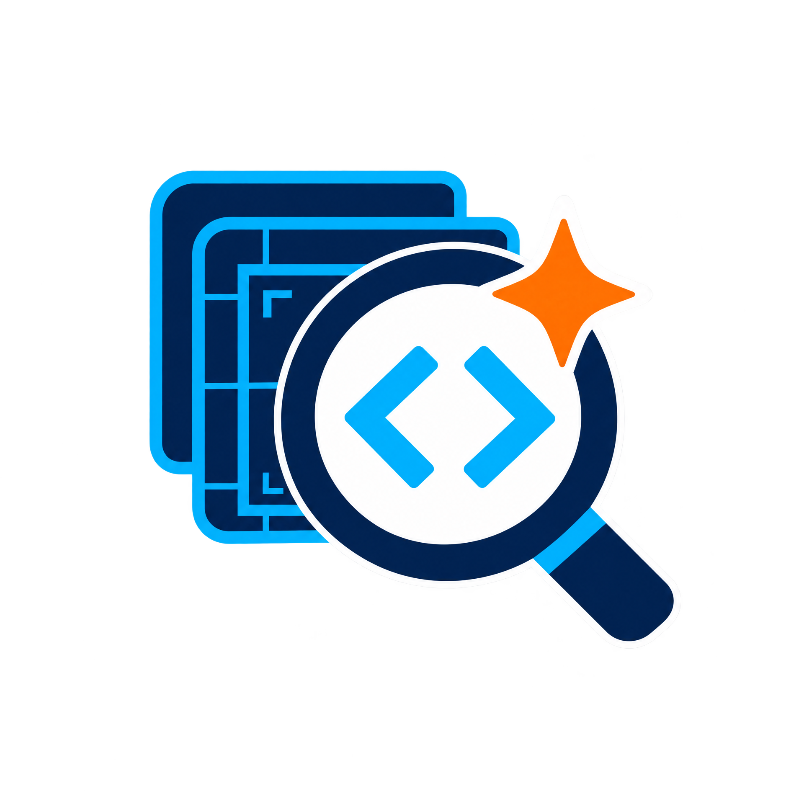
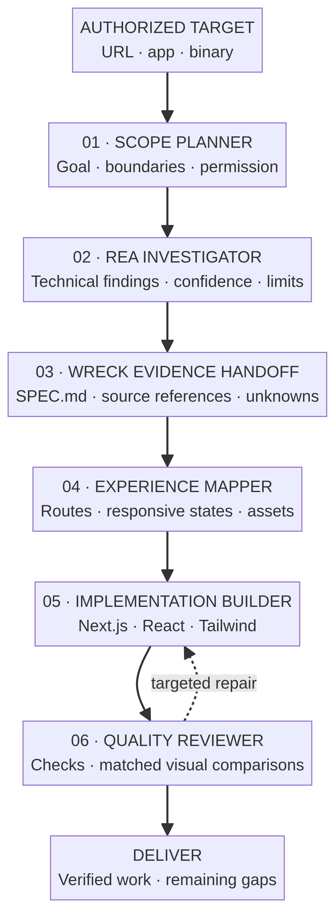

<div align="center">
  
  <h1>WRECK</h1>
  <p><strong>Web Reverse Engineering &amp; Cloning Kit</strong></p>
  <p>Investigate an authorized app. Turn evidence into a tested, modern rebuild.</p>
  <p>
    
    
    
    
  </p>
  <p>
    <a href="https://github.com/morluto/rea"></a>
    <a href="https://github.com/JCodesMore/ai-website-cloner-template"></a>
    
    
  </p>
</div>

<p align="center"></p>

## WRECK is our framework—not a wrapper

WRECK owns the **agent framework**: a provider interface, tool registry, MCP-over-stdio client, permissioned workspace tools, five specialist agents, and a sequential orchestrator. It can use different LLM providers and MCP-compatible tools. There is no hard-coded model ID, vendor account, or dependency on a single coding agent.

The repository also contains full source snapshots of **REA** and **AI Website Cloner** as capability sources and examples. Their code remains in distinct folders with original licenses and attribution. WRECK’s runtime, agents, tool policies, and orchestration are original WRECK code; the upstream projects do not define WRECK’s identity.

### WRECK’s own agent team

| Agent | Role | Tool access |
|---|---|---|
| `scope-planner` | Define the target boundary, goal, and safe investigation plan. | No external tools by default. |
| `rea-investigator` | Gather technical evidence and mark confidence/limitations. | MCP server named `rea`, if configured. |
| `experience-mapper` | Map routes, responsive states, interactions, and assets. | MCP server named `browser` or `web`, if configured. |
| `implementation-builder` | Build the supported requirements in the generated app. | Project file tools; writes only with `--allow-write`. |
| `quality-reviewer` | Check the result and report actual tests, comparisons, and gaps. | Read-only project tools; fixed `npm run check` only with `--allow-check`. |

## How it works



The editable source for this map is [`docs/wreck-pipeline.mmd`](docs/wreck-pipeline.mmd). The handoff artifact is `docs/research/wreck/SPEC.md`: it links findings, source references, confidence, limitations, observed visual states, implementation requirements, and verification.

## Quick start

```bash
git clone https://github.com/EdgeAgent/WRECK.git
cd WRECK
node src/cli.mjs doctor
node src/cli.mjs agents
node src/cli.mjs init https://example.com --dir ../example-rebuild --name Example
```

Set provider credentials in your shell’s secret store (never commit them):

```bash
export WRECK_LLM_BASE_URL="https://your-provider.example/v1"
export WRECK_LLM_API_KEY="..."
export WRECK_LLM_MODEL="model-id-supported-by-that-provider"
```

The built-in provider adapter speaks the OpenAI Chat Completions-compatible format. WRECK has a provider interface for custom adapters when a provider uses a different API protocol; it does not guess or silently select a model.

Run the five agents in sequence:

```bash
node src/cli.mjs run --dir ../example-rebuild --goal "Rebuild the authorized product landing page" --allow-write --allow-check
```

The generated Next.js app requires Node.js 24+; install its dependencies in that project before asking Quality Reviewer to run its checks. `--allow-write` and `--allow-check` are explicit opt-ins because an LLM may change project files and a package check runs project scripts. When writes are enabled, WRECK also saves a timestamped stage report under `docs/research/wreck/agent-runs/`; review it before sharing. Omit these flags to keep the agent read-only. Run one role independently with `node src/cli.mjs agent <agent-id> --dir <project> --input "..."`.

## Connect tools

WRECK uses **MCP over stdio** as a general tool protocol. In the generated `wreck.config.json`, configure only servers you trust. For example, the REA server can be assigned to the investigator role; a compatible browser server can be assigned to the mapper and builder roles:

```json
{
  "mcpServers": [
    { "name": "rea", "command": "rea", "args": ["mcp"] },
    { "name": "browser", "command": "your-browser-mcp", "args": [], "agents": ["experience-mapper", "implementation-builder"] }
  ]
}
```

The `rea` preset name receives tool access only in `rea-investigator`; `browser`/`web` names go to the mapping/build roles. Any custom server can be restricted with its `agents` list. WRECK does not install MCP servers or modify agent configuration for you. Follow [REA’s official setup](https://github.com/morluto/rea) and the chosen browser server’s documentation. In supported coding agents, the included cloner skill remains available for its Map → Observe → Build → Compare workflow.

## WRECK core and included source

```text
src/core/                       WRECK agent runtime and multi-agent orchestrator
src/agents/                     WRECK-owned specialist role catalog
src/providers/                  Provider adapters and plugin boundary
src/tools/                      MCP and permissioned workspace adapters
packages/rea/                   REA + pinned submodule source + original notices
apps/website-cloner/             Complete cloner source snapshot + its MIT license
test/                            WRECK-owned framework tests
docs/                            Architecture, research notes, maps, artwork
THIRD_PARTY_NOTICES.md            Source attribution and pinned revisions
```

Read the [agent framework guide](docs/agent-framework.md), [architecture](docs/architecture.md), [research notes](docs/research-notes.md), [brand questionnaire](BRAND-QUESTIONNAIRE.md), and [upstream notices](THIRD_PARTY_NOTICES.md).

## Compatibility and limits

- WRECK’s default provider adapter targets OpenAI Chat Completions-compatible APIs (including compatible hosted or local servers). Add a custom provider adapter for a different API shape.
- WRECK’s generic tool boundary supports MCP servers over stdio. Other transports can be added behind the same tool interface.
- The included REA snapshot requires Node `^22.19.0 || ^24.11.0 || >=26.0.0` and may need platform-specific tools. The generated website app declares Node `>=24`.
- Browser inspection requires a browser-capable coding agent or a configured browser MCP server; screenshot understanding requires a vision-capable model. WRECK passes supported MCP image results to the provider with size limits. Without those tools/capabilities, agents must say evidence was unavailable.
- Root checks cover WRECK’s own code, not every upstream test suite. This is an agent framework, not a promise of automatic or pixel-perfect reconstruction.

## Responsible use

Use WRECK only on systems you own or are explicitly authorized to analyze. Follow site terms and applicable law. Do not bypass access controls, extract secrets/private data, phish, impersonate a brand, or misrepresent another party’s work. Keep credentials out of files and logs, preserve licenses, and cite evidence.

## Brand it as yours

WRECK is a starting brand. Want a different name, acronym, palette, or audience? Fill out [BRAND-QUESTIONNAIRE.md](BRAND-QUESTIONNAIRE.md), and the identity can be updated consistently across the repository, badges, icon, artwork, and docs.

## License and provenance

WRECK-authored code is MIT licensed. Full upstream source snapshots remain under their original MIT notices in `packages/rea/` and `apps/website-cloner/`. See [THIRD_PARTY_NOTICES.md](THIRD_PARTY_NOTICES.md) for the exact revisions and ownership.
